# Modelo de dados

Fonte: `supabase/migrations/` (0001 a 0005). Postgres no Supabase, com pgvector. **Row Level Security ligada nas 43 tabelas**; o teste `scripts/rls-test.mjs` prova que um usuário não lê nem altera dados de outro (16 verificações).

Campos sensíveis (`profiles.ministry_role_enc`, `preferences.lenses_enc`) são criptografados pela aplicação com AES-256-GCM (`lib/security/field-crypto.ts`); o banco nunca vê o texto original.

```mermaid
erDiagram
  AUTH_USERS ||--|| PROFILES : "user_id"
  AUTH_USERS ||--|| PREFERENCES : "user_id"
  AUTH_USERS ||--o{ CONSENT_RECORDS : "user_id"
  AUTH_USERS ||--o{ SESSIONS : "user_id"
  SESSIONS ||--o{ MESSAGES : "session_id"
  MESSAGES ||--o{ MESSAGE_CITATIONS : "message_id"
  MESSAGES ||--o{ ANSWER_FLAGS : "message_id"
  SESSIONS ||--o| SESSION_SUMMARIES : "session_id"
  SESSIONS ||--o| SESSION_CLOSINGS : "session_id"
  SESSIONS ||--o{ REVIEW_CARDS : "session_id"
  REVIEW_CARDS ||--o{ REVIEW_LOGS : "card_id"
  AUTH_USERS ||--o{ NOTEBOOK_ITEMS : "user_id"
  AUTH_USERS ||--o{ BOOKMARKS : "user_id"
  AUTH_USERS ||--o{ LESSON_PLANS : "user_id"
  SERMON_TYPES ||--o{ SERMON_OUTLINES : "sermon_type_id"
  AUTH_USERS ||--o{ SERMON_OUTLINES : "user_id"
  AUTH_USERS ||--o{ PASTORAL_EVENTS : "user_id (sem texto)"
  WORKS ||--o{ BIBLE_VERSIONS : "work_id"
  BIBLE_VERSIONS ||--o{ BIBLE_VERSES : "version_id"
  WORKS ||--o{ CHUNKS : "work_id"
  WORKS ||--o{ INGEST_RUNS : "work_id"
  KG_ENTITIES ||--o{ KG_RELATIONS : "from_id / to_id"
  PLANS ||--o{ SUBSCRIPTIONS : "plan_id"
  AUTH_USERS ||--o{ SUBSCRIPTIONS : "user_id"
  AUTH_USERS ||--o{ ENTITLEMENTS : "user_id"
  AUTH_USERS ||--o{ DEVICES : "user_id"
  AUTH_USERS ||--o{ USAGE_COUNTERS : "user_id, day"
```

## Quem lê e escreve o quê

| Grupo | Tabelas | Leitura | Escrita |
| --- | --- | --- | --- |
| Do usuário | profiles, preferences, consent_records, sessions, messages, message_citations, session_summaries, session_closings, review_cards, review_logs, notebook_items, bookmarks, lesson_plans, sermon_outlines, devices | só o dono | só o dono |
| Sinalizações | answer_flags | o autor e os revisores | o autor cria; revisores decidem |
| Crise pastoral | pastoral_events | ninguém pela API (só métricas no servidor) | o próprio usuário insere; **sem texto** |
| Cobrança | subscriptions, entitlements, usage_counters | só o dono | só o servidor |
| Pagamentos e auditoria | payment_events, audit_logs, prompt_versions, ingest_runs | só admin (payment_events: ninguém) | só o servidor |
| Conteúdo de referência | sermon_types, original_words, lexicon_entries, cross_refs, kg_*, map_routes, timelines, models3d, plans, app_config | todos | só o servidor |
| Acervo bíblico | works, bible_versions, bible_verses | só obras habilitadas e aprovadas | só o servidor |
| Trechos de busca | chunks | ninguém pela API (o servidor busca) | só o servidor |
| Conteúdo próprio | own_notes, illustrations | só publicadas/aprovadas (revisores veem tudo) | revisores e servidor |

`profiles.role` só muda pelo servidor: um gatilho impede que o usuário se promova a administrador.

## Banco de referência (Neon, D-20)
`original_words`, `lexicon_entries`, `cross_refs` e `verse_map` vivem no Neon (`neon/0001_reference.sql`), com a mesma forma das tabelas do Supabase, que ficam vazias e sem uso (migrations 0005 e 0009 mantidas só pela história). Nenhum dado pessoal está no Neon.
